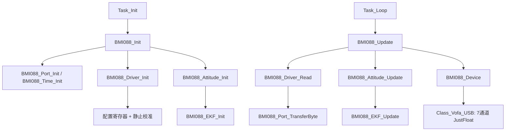

# BMI088 姿态模块

来源：`NEXT-E-infantry_omni/example/Chassis/Components/IMU/BMI`。
保留来源四元数 EKF 算法和作者信息，适配 STM32H723、SPI2 和工程现有 M7 CMSIS-DSP 库。
本模块只解算姿态，不进行位置或速度积分。支持板载一个 BMI088，所有接口由同一前台调用。

## 文件分类

新增固件模块由 16 个文件合并为 4 个文件，统一使用工程的 `dvc_` / `alg_` 命名，不再套多级子目录。

```text
User_File/2_Device/IMU/BMI088/
├── dvc_bmi088.h       对外结构体、错误码、参数和设备接口
├── dvc_bmi088.c       寄存器、SPI2、DWT、采集校准及更新流程
├── alg_bmi088.h       设备内部使用的姿态初始化与更新接口
└── alg_bmi088.c       私有滤波结构、矩阵运算、四元数 EKF 和七参数转换
```

旧 `bmi088_types.h` 合入 `dvc_bmi088.h`；旧入口、driver 和 port 合入 `dvc_bmi088.c`；
旧 attitude、quaternion_ekf 和 kalman_filter 合入 `alg_bmi088.c`。
旧文件及子目录已移除，原版本备份在 `build/bmi088-before-file-merge-20261120`。

## 结构体关系

| 类型 | 成员或用途 |
| --- | --- |
| `BMI088_Device_t` | 单个设备对象，包含 attitude、sample、calibration、status |
| `BMI088_Attitude_t` | 原七个姿态字段；角度 °，角速度 rad/s |
| `BMI088_Sample_t` | 已校准的 accel_mps2[3]、gyro_radps[3]、temperature_c |
| `BMI088_Calibration_t` | 陀螺零偏、加速度比例、重力模长及标定温度 |
| `BMI088_Status_t` | initialized、ready、error |
| `BMI088_Error_t` | 公共错误枚举 |
| `BMI088_RegisterConfig_t` | driver 内部的寄存器地址、配置值、错误码 |
| `BMI088_EKF_t` | algorithm 内部四元数、零偏估计与滤波状态 |
| `BMI088_Kalman_t` | alg_bmi088.c 私有矩阵运算数据，替代旧 KalmanFilter_t |

对外只需包含 `dvc_bmi088.h`，无需依赖 HAL、寄存器或滤波器内部结构。
寄存器配置类型留在 `dvc_bmi088.c`，EKF 和 Kalman 类型留在 `alg_bmi088.c`；
这些实现细节不放进公共头文件，内部辅助函数和滤波状态使用 `static`。

## 调用与读取

```cpp
#include "2_Device/IMU/BMI088/dvc_bmi088.h"

// 已在 Task_Init 中调用；初始化成功后再次调用不会重复校准。
bool ok = BMI088_Init();

// 已在 Task_Loop 中约每 1ms 调用。
if (BMI088_Update()) {
    float yaw = BMI088_Device.attitude.yawAngle;
    float total_yaw = BMI088_Device.attitude.yawTotalAngle;
    float pitch = BMI088_Device.attitude.pitchAngle;
    float roll = BMI088_Device.attitude.rollAngle;
    float yaw_speed = BMI088_Device.attitude.yawSpeed;
    float pitch_speed = BMI088_Device.attitude.pitchSpeed;
    float roll_speed = BMI088_Device.attitude.rollSpeed;
}
```

示例中的初始化和更新由现有任务负责，业务代码读取 `BMI088_Device` 即可，不要在多个上下文重复更新。
`BMI088_Device` 是模块维护的数据，业务代码不应直接改写其状态或校准参数。



`BMI088_Update()` 使用临时采样和临时姿态，整帧成功后才发布。中途 SPI 失败或解算失败时，
上次成功的 sample、attitude 和 calibration 保留，`status.ready=false`；不要将保留值当作新数据。

上电保持静止约 3 秒，用于启动及零偏校准。失败后主任务等待 3 秒再重试，直到初始化成功。
加热关闭，不使用原车固定零偏。陀螺静止峰峰值阈值为 0.15 rad/s，宏位于 `dvc_bmi088.h`；
仍检查陀螺均值、重力均值、加速度波动和超时。

`status.error` 为 0 表示成功；0x20 为 SPI 失败、0x21 为静止校准失败、0x22 为滤波初始化失败，
0x23 为更新周期或解算结果无效、0xFF 为芯片 ID 不匹配，其余寄存器错误见 `dvc_bmi088.h`。
初始化失败时 `status.initialized=false`；首次成功采样解算后 `status.ready=true`。

## 轴向与 USB 输出

yaw 绕 Z、pitch 绕 Y、roll 绕 X，沿用传感器轴向，未加入整车安装旋转。
`yawAngle` 约为 -180～180°，`yawTotalAngle` 连续累计跨圈；没有磁力计，yaw 为相对角度且长期会漂移。

PA11/PA12 为已有 USB D-/D+，通过板载 USB 数据接口连接电脑；这两根线不能按 UART TX/RX 接 USB 转 TTL。
VOFA+ 选择对应 COM 口，协议 **JustFloat**、7 个通道；USB 虚拟串口波特率可设 115200。
每 10ms 发送七个小端 float，顺序为 yawAngle、yawTotalAngle、pitchAngle、rollAngle、yawSpeed、pitchSpeed、rollSpeed，
后接 `00 00 80 7F` 帧尾，共 32 字节。数据流不混入错误文本；失败原因用调试器查看 `status.error`。

现有 SPI2 配置为 Mode 3、8 位、MSB、10MHz：PB13/SCK、PC1/MOSI、PC2_C/MISO、PC0/加速度片选、PC3_C/陀螺片选。
未新增 DMA 或 EXTI 回调。旧 `2_Device/BSP/BMI088` 未启用。当前主任务只测试 IMU，受控电源关闭，保留看门狗。

## 验证

主机测试入口为 `tests/firmware/run_bmi088.py`，编译实际 `dvc_bmi088.c` 和 `alg_bmi088.c`，仅模拟 HAL 与 DWT 寄存器。
需要本机 C 编译器及 CMSIS-DSP 标量矩阵源码；Windows Clang 需要 lld-link 和 C 标准库头文件：

```powershell
python tests/firmware/run_bmi088.py --cc "D:/MATLAB2024b/toolbox/sldrt/clang/win64/clang.exe" --link "D:/ST/STM32CubeCLT/st-arm-clang/bin/lld-link.exe" --c-include "D:/ST/STM32CubeCLT/GNU-tools-for-STM32/arm-none-eabi/include" --dsp-source "E:/Stm32 Project/HAL/NEXT-E-infantry_omni/example/Chassis/Drivers/CMSIS/DSP/Source/MatrixFunctions"
```

加 `--fast-math` 可验证 Release 优化。测试覆盖校准、缺失传感器、寄存器错误、SPI 超时、
重复初始化、半帧采集失败时保留整帧数据、跨圈 yaw 和 pitch/roll 轴向。
主机测试与编译不能替代上板测试，重构后仍需核对实物通信、安装轴向和温漂。
